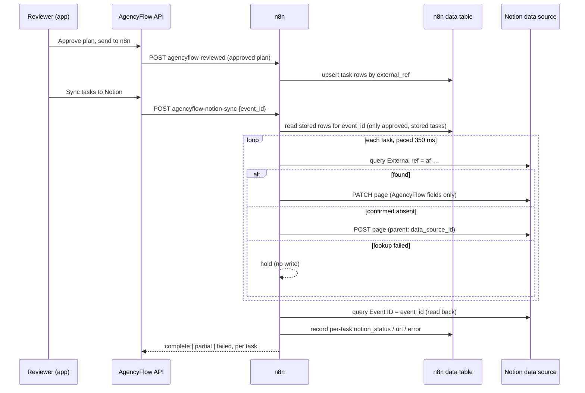

# Notion sandbox sync (optional)

Approved tasks can be copied from n8n into a **separate, fictional Notion workspace**. This is an independent portfolio demo: it never touches a real client's workspace, sends nothing to clients, and is **off by default**.

## How it works

The app sends only the `event_id`. n8n builds the Notion pages from its own stored rows, so nothing that skipped approval or the receiver's validation can reach Notion.

## Field map (Notion data source "AgencyFlow AI tasks (fictional demo)")

| Notion property | Type | From | Updated on re-sync? |
|---|---|---|---|
| Name | title | task title | yes |
| External ref | rich text | `af-<run>-<hash>#<n>`: the stable de-duplication key | yes (same value) |
| Event ID | rich text | approved plan's event id | yes |
| Campaign | rich text | campaign name | yes |
| Client | rich text | client name as entered (fictional) | yes |
| Role | rich text | task role, as text: no people are assigned | yes |
| Priority | select (high, medium, low) | task priority | yes |
| Due | date | due date computed from the confirmed deadline | yes |
| Description | rich text | task detail | yes |
| Source | rich text | "AgencyFlow AI (independent fictional demo)" | yes |
| Status | select (To do, In progress, Done) | "To do" on create | **no**: the team's progress in Notion is kept |

## Guarantees and how they are tested

| Requirement | Mechanism | Test |
|---|---|---|
| External writes off by default | App flag `NOTION_SYNC_ENABLED` **and** n8n setting `notion_enabled`. The default credential is a placeholder that cannot write | `test_notion_sync_is_off_by_default_and_sends_nothing`, `test_disabled_sync_writes_nothing` |
| Only after human approval | App requires status `sent`, and n8n reads only rows stored by the approval receiver | `test_notion_sync_requires_approved_and_delivered_plan`, `test_only_approved_stored_tasks_can_sync` |
| No duplicates on resend, replay, restart or retry | Query by `External ref` before every create; page writes are not auto-retried; the receiver blocks replays and tampering | `test_resend_replay_and_tamper_never_duplicate`, `test_lost_create_response_does_not_duplicate` |
| Partial batches recover | Each task succeeds or fails on its own; a retry re-checks every task and creates only the missing ones | `test_partial_failure_then_retry_fixes_only_the_gap` |
| Success only after read-back | Final query by `Event ID`; title, priority, due date, role and campaign must match | `test_full_sync_maps_fields_and_reads_back`, `test_resync_repairs_edited_fields_but_keeps_reviewer_status` |
| Rate limits and permission errors explained | Reads retry 3 times (1.5 s apart); requests paced at 350 ms; Notion error codes mapped to plain messages | `test_rate_limited_read_is_retried_automatically`, `test_permission_error_creates_nothing_and_explains` |
| Missing or bad credential | Notion 401 → "Notion rejected the credential…" | `test_missing_or_bad_credential_is_explained` (mock) and one real call to api.notion.com with the placeholder token |
| Token never leaves n8n | Generic header-auth credential in n8n's encrypted store; the endpoint allowlist is `api.notion.com` (plus the local mock) | `test_setup_refuses_non_notion_endpoints` |

Live tests (`tests/integration`, 11 tests) run the real n8n workflow against `tests/notion_mock/server.js`, a small stand-in that implements the 2025-09-03 data-source endpoints and can inject failures. App-side behaviour has 6 more unit tests.

## Compatibility notes (checked 2026-11-13)

- n8n 2.47.4; Notion API version `2025-09-03`. Pages are created with `parent: {type: "data_source_id"}` and found with `POST /v1/data_sources/{id}/query`. Legacy `database_id` parents are not used.
- n8n's built-in **Notion API credential forces `Notion-Version: 2022-02-22`** on HTTP requests, which predates data sources. The mock caught this, so the workflow uses a generic **Header Auth** credential (`Authorization: Bearer …`) and sends the version header itself.
- `2026-03-11` renames `archived` to `in_trash`. The workflow never sends or reads `archived`, so it is unaffected.

## Owner setup (needs your accounts; about 10 minutes)

1. In Notion, create a **new, separate workspace** for the demo (fictional data only).
2. Create an **internal integration** in that workspace (Settings → Connections → Develop or manage integrations). Give it only *Read content*, *Update content* and *Insert content*.
3. Create an empty page, for example "AgencyFlow sandbox", and share it with the integration (••• → Connections).
4. Store the secret in n8n, entered with a hidden prompt: `./scripts/notion-connect.ps1`
5. Create the data source under that page and enable writes: `./scripts/notion-setup.ps1 -ParentPageId <page id from its URL> -Enable`
6. Start the app with `$env:NOTION_SYNC_ENABLED = '1'`, approve a plan, send it to n8n, and click **Sync tasks to Notion**.

To turn writes off again, run `./scripts/notion-setup.ps1 -DataSourceId <id>` without `-Enable`, or unset `NOTION_SYNC_ENABLED`.

## Limitations

- Single-user demo: one sync per plan at a time (an app-side lock). Two n8n instances syncing the same plan at the same moment could still race between query and create. Notion has no unique constraint to prevent that.
- Pages deleted in Notion are recreated on the next sync. Tasks removed from a plan aren't deleted from Notion, because plans are locked after approval.
- Read-back uses one query page (up to 100 tasks), and plans are capped at 18 tasks.
- The live end-to-end run against a real Notion workspace hasn't been done yet: it needs the owner's sandbox credentials (steps above). Everything else was tested against the mock and one real unauthenticated call.
